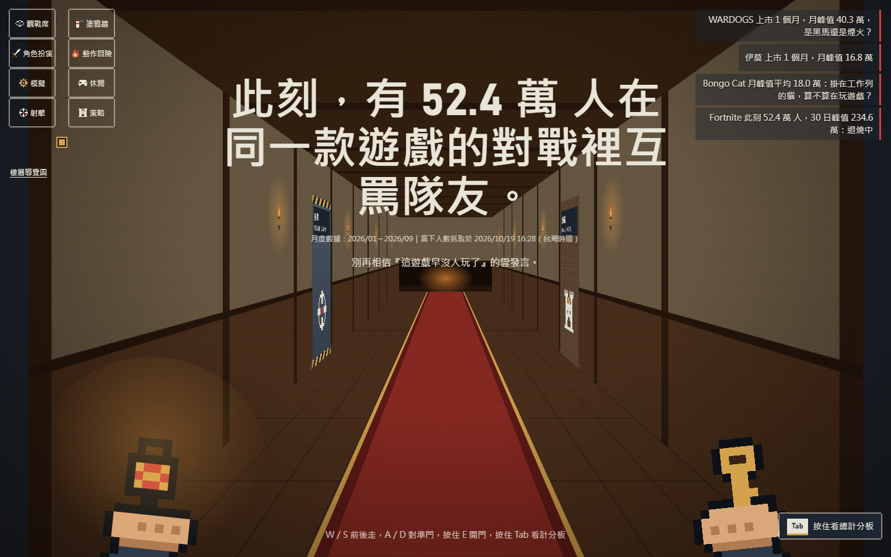
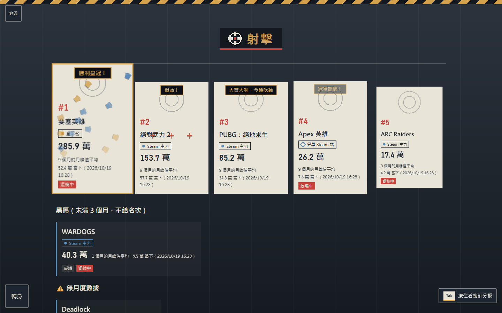
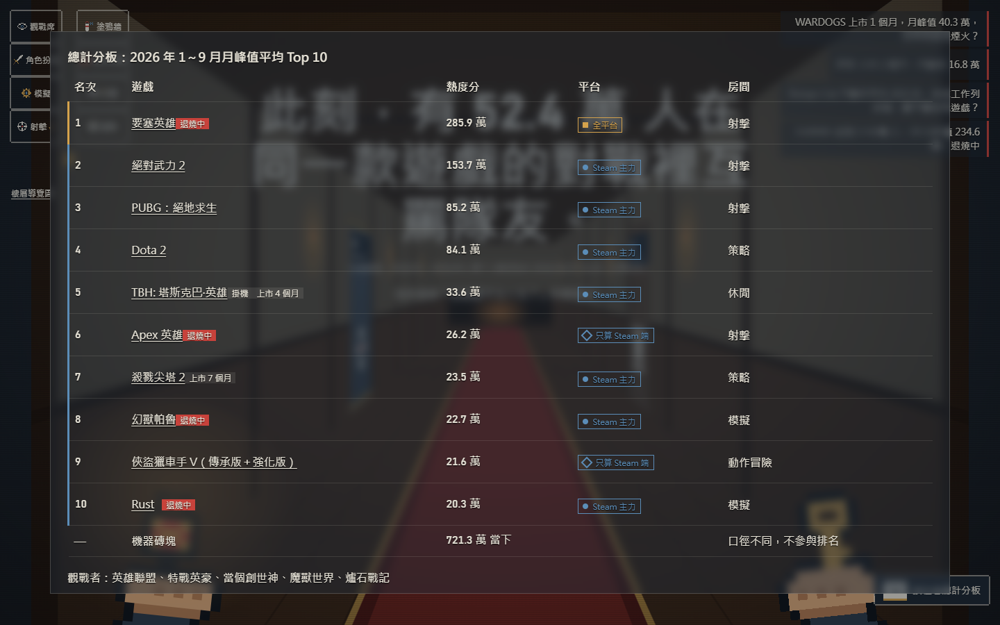

# 2026 遊戲熱度旅館

一間可以走進去逛的「遊戲熱度旅館」：用第一人稱走過走廊，推開六種遊戲類型的房門，看 2026 年 1～9 月哪些遊戲最多人玩。所有人數都是真實數據，每個數字旁邊都寫著來源、口徑和抓取時間。

- **線上版：** https://wilson0503.github.io/game-heat-2026/
- **規格書：** [SPEC.md](SPEC.md)（v0.5）
- **驗收報告：** [docs/acceptance-2026-10-19.md](docs/acceptance-2026-10-19.md)

整個網站只有一個 `index.html`（約 165 KB），不用框架、不載入圖片或網路字型，下載後直接用瀏覽器打開也能離線使用。


## 怎麼玩

| 動作 | 電腦 | 手機 |
|---|---|---|
| 開旅館大門 | 空白鍵 | 點大門 |
| 聽管家小編介紹 | 點「下一句」 | 點「下一句」 |
| 前進／後退一站 | W／S 或 ↑／↓ | 上滑／下滑 |
| 轉向左門／右門 | A／D 或 ←／→ | 左滑／右滑 |
| 開房門 | 對準門按住 E，或點門 | 長按門 |
| 翻開房間榜單 | 點布幕 | 點布幕 |
| 看遊戲詳情 | 點卡片 | 點卡片 |
| 離開房間 | Esc 或「轉身」 | 「轉身」或返回 |
| 總計分板（Top 10） | 按住 Tab | 點「總計分板」 |
| 平面版（樓層導覽圖） | 左上「樓層導覽圖」 | 左上「地圖」 |

系統設定了「減少動態效果」時，網站會直接打開平面的樓層導覽圖，也不播放動畫。

## 有什麼

**旅館大門。** 第一次打開時站在夜色中的旅館門口。管家小編會用真實數據介紹：收錄幾款遊戲、目前第一名是誰、最近大家在聊什麼。按空白鍵，兩扇門往內打開，鏡頭推進走廊。同一個分頁只出現一次。

**旅館走廊。** 木地板、紅地毯、牆上的火把，盡頭是壁爐。畫面下方是你的雙手：左手提燈籠，右手拿房間鑰匙。走路時畫面會晃，轉身時手會甩。門依房間總熱度排列，越熱門的類型離入口越近；門縫透出的光越亮，代表那個類型越多人玩。



**六間房。** 射擊（靶場）、策略（作戰室）、模擬（藍圖）、休閒（街機）、角色扮演（公會大廳）、動作冒險（西部黃昏）。第一次進房時榜單是蓋著的，要自己翻開；從第 5 名開始發牌、第 1 名壓軸，每張卡片有那款遊戲自己的特效，例如 CS2 的「爆頭！」、PUBG 的「大吉大利，今晚吃雞」。



**總計分板。** 在任何地方按住 Tab，叫出綜合 Top 10。點遊戲會直接走到那間房並翻開它。



**其他：** 左上角小地圖（去過的房間會打勾，點了直接過去）、右上角擊殺訊息（新遊戲黑馬、標籤爭議、退燒中的遊戲）、走廊盡頭的觀戰席（查不到人數的遊戲）與塗鴉牆投票。

## 數據怎麼算

- **熱度分** = 2026 年 1～9 月，每個月同時在線峰值的平均。只算有數據的月份；至少要有 3 個月才進排名，不滿 3 個月的放進「黑馬」。
- **只用一種口徑：** 同時在線人數。不混用月活、觀看數或第三方推估。
- **候選名單：** 抓取當天（2026/10/19）Steam 官方排行前 100 名，加上 Fortnite 和 Roblox。所以年初很紅、現在已退燒的遊戲不會出現。
- **平台徽章：** Steam 遊戲只算 PC 端（🔷 只算 Steam 端、● Steam 主力）；Fortnite 是全平台；Roblox 口徑不同，只列當下人數、不參與排名。
- **抓不到就寫抓不到：** 沒有月度數據的遊戲顯示「⚠️ 無月度數據」，不補數字。
- 社群梗都標「（轉述）」；不使用官方 Logo、立繪或截圖，所有圖案都是 CSS 和像素 SVG 畫的。

| 來源 | 提供 |
|---|---|
| Steam `GetGamesByConcurrentPlayers` | 前 100 名的當下人數、24 小時峰值 |
| Steam `appdetails`、SteamSpy | 繁中名稱、類型、玩家標籤（分房用） |
| Steamcharts | 每月峰值、近 30 日峰值 |
| fortnite.gg | Fortnite 每日峰值與當下人數 |
| Rolimons | Roblox 各體驗的在線人數加總 |

## 更新數據

需要 Python 3.12（只用標準函式庫）。

```bash
python tools/fetch_data.py   # 重抓所有來源，舊檔移到 data/archive/
python tools/build_data.py   # 重算排名與分房，寫回 data/site_data.json 和 index.html
```

遇到 Cloudflare 等防機器人驗證時，程式會記錄失敗並跳過，不會嘗試繞過。

## 測試

```bash
pip install playwright
python -m unittest discover -s tests
```

端對端測試用 Playwright 驅動 Microsoft Edge，涵蓋電腦（1440×900）與手機觸控（375×812）：數據一致性、鍵盤與觸控操作、網址直達、減少動態效果、離線、無橫向捲動等，共 118 個測試。

## 檔案

| 路徑 | 內容 |
|---|---|
| `index.html` | 整個網站（數據內嵌在 `<script id="site-data">`） |
| `SPEC.md` | 規格書 |
| `data/` | 原始抓取結果、人工修正清單 `manual.json`、文案 `copy.json`、整理後的 `site_data.json` |
| `tools/` | 抓數據、算排名、檢查文案的程式 |
| `tests/` | 單元測試與端對端測試 |
| `docs/screenshots/` | 截圖 |
